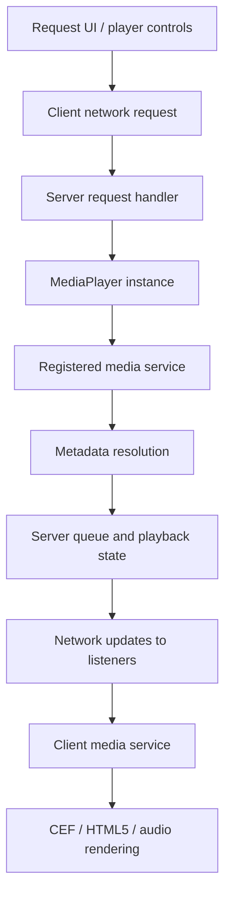

# Architecture

Media Player Redux separates authoritative playback state on the server from browser rendering and input on each client.

## Runtime layers

| Layer | Responsibility |
|---|---|
| Entities | World objects such as `mediaplayer_tv` and `mediaplayer_spatial_anchor` |
| MediaPlayer types | Queue, state, owner, listeners, permissions, synchronization |
| Services | Match URLs, resolve metadata, and implement provider-specific playback |
| Browser/UI | DHTML panels, browser pool, request panel, sidebar, screen rendering |
| Supporting systems | SQLite metadata/history, CAMI, events, translations, configuration |

## Runtime flow

The following overview shows how a request moves through the main runtime layers. The server owns request validation, queue state, and synchronization; clients handle local playback rendering.

## MediaPlayer types

Types are registered through `MediaPlayer.Register` in `lua/mediaplayer/sh_mediaplayer.lua`.

- **base** — queue, playback state, owner, repeat/shuffle/lock, listeners, and snapshot/network helpers.
- **entity** — binds a player to a screen entity and handles screen drawing.
- **spatial** — binds a player to an anchor, updates listeners by distance, and restricts services to a whitelist.
- **mimic** — mirrors a source media player on another screen. The mimic tool manages linking and restoration.

The server owns queue and playback decisions. Clients receive snapshots and media updates, then render/play the current service locally.

## Media services

Services are registered by `MediaPlayer.RegisterService` in `sh_services.lua`. The loader explicitly loads the abstract `base` service first, followed by browser/resource/audio service families.

A service typically has:
- `shared.lua`: identity, URL matching, parsing, and shared behavior.
- `init.lua`: server-side metadata and request handling.
- `cl_init.lua`: client-side browser/audio playback.

Some services use single-file implementations such as `directmedia.lua` or `webpage.lua`. See [Video services](video-services.md) and [Custom video service](custom-video-service.md).

## Networking and listeners

Server-side network receivers are defined in `sv_requests.lua`; player state and media serialization live in the player base networking module. Requests are associated with a media-player ID and validated on the server. The server rate-limits incoming request messages and checks listener membership, queue state, ownership, and privileges before applying actions.

Entity players and spatial players manage listeners differently:
- Screen entities use the base transmission policy.
- Spatial players add connected human players within `mediaplayer_spatial_hear_radius`.

Only listeners receive the relevant media-player updates.

## Persistence

SQLite is used for:
- `mediaplayer_metadata`: cached title, duration, thumbnail, and provider metadata. Entries older than one week are treated as expired.
- `mediaplayer_history`: requested media and requester information.

The `mediaplayer_clearcache` command clears the metadata cache only; it does not clear request history.

## Extension points

| Goal | Where |
|---|---|
| Add a provider | `lua/mediaplayer/services/` — [Custom video service](custom-video-service.md) |
| Add a player type | `lua/mediaplayer/players/` and `MediaPlayer.Register` |
| Add a screen model | `lua/autorun/mediaplayer_spawnables.lua` |
| Add a tool | `lua/weapons/gmod_tool/stools/` |
| Integrate admin permissions | CAMI and `MediaPlayer.PlayerHasPrivilege` |
| Observe player lifecycle | MediaPlayer hooks and events — [Development](development.md) |

## Related

- [Development](development.md)
- [Permissions](permissions.md)
- [Configuration](configuration.md)
