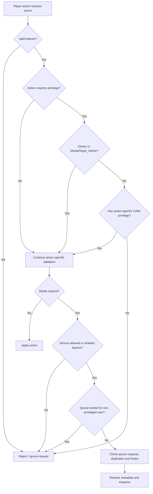

# Permissions

Media Player Redux integrates with **CAMI** (Common Admin Mod Interface), allowing supported admin mods such as ULX, SAM, and ServerGuard to grant granular privileges.

Implementation: `lua/mediaplayer/sh_cami.lua`.

## Ownership and player controls

The media-player owner can normally control their own player. Privileges extend selected actions to other players' media players.

| CAMI privilege | Default minimum access | Purpose |
|---|---|---|
| `MediaPlayer_Admin` | admin | General elevated control over other players' media players |
| `MediaPlayer_Skip` | admin | Skip current media without relying on a vote |
| `MediaPlayer_Seek` | admin | Seek timed media |
| `MediaPlayer_Remove` | admin | Remove queued media belonging to other players |
| `MediaPlayer_QueueControl` | admin | Toggle repeat, shuffle, and queue lock |
| `MediaPlayer_BypassWhitelist` | admin | Bypass a player's service whitelist, such as the spatial-player whitelist |
| `MediaPlayer_ClearCache` | superadmin | Clear the SQLite metadata cache |

`MediaPlayer_Admin` is the general privilege. For integrations, the addon exposes helpers to check the general privilege or a specific action privilege.

When CAMI is unavailable, the helper falls back to `ply:IsAdmin()`. The cache-clear command has its own stricter authorization path: server console and single-player host are accepted; multiplayer players require superadmin-level access.

## Permission decision flow

The checks are performed server-side. Ownership and the general `MediaPlayer_Admin` privilege grant broad control; individual actions can also have their own granular privilege. Requesting media has additional listener, whitelist, queue-lock, capacity, and duplicate checks.



CAMI's general helper falls back to `IsAdmin()` when CAMI is unavailable. The cache-clear command has a separate, stricter authorization path documented in [Console commands](commands.md).

## Request restrictions

A request must come from a valid listener of the target media player. The server then checks:
- whether the player is allowed to control/request media on that player;
- whether the queue is locked;
- whether the requested service is permitted by the player's service whitelist;
- whether the queue has space and the item is not already queued.

Spatial media requires the creator/owner or an appropriately privileged administrator to request/control its media. The spatial service whitelist can be bypassed by `MediaPlayer_BypassWhitelist`.

## Lua helper API

```lua
MediaPlayer.PlayerHasPrivilege(ply, "MediaPlayer_Skip")
MediaPlayer.PlayerHasAnyPrivilege(ply, "MediaPlayer_Skip")
MediaPlayer.PlayerHasAnyMediaPrivilege(ply)
```

Use these helpers instead of hard-coding admin-mod-specific checks. Server-side request handlers remain authoritative; client-side UI visibility is not a security boundary.

## Related

- [Usage](usage.md)
- [Spatial Media](spatial-media.md)
- [Console commands](commands.md)
