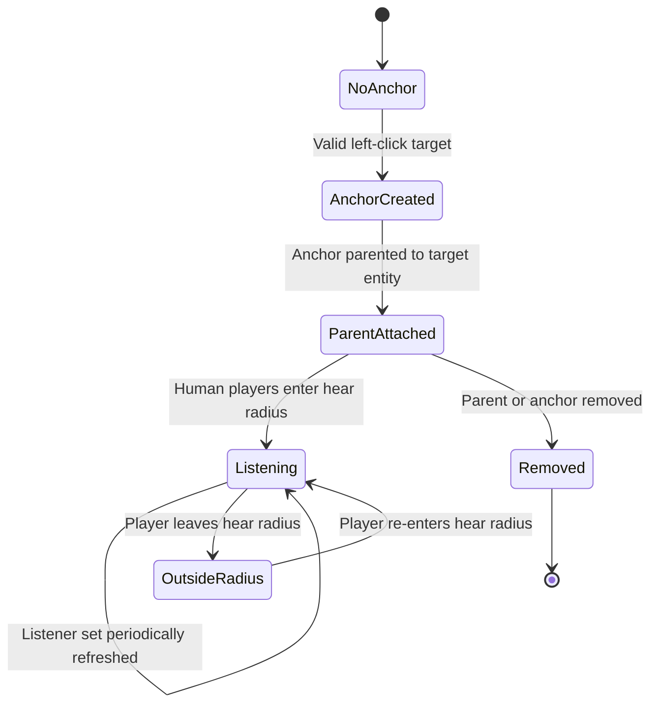

# Spatial Media

Spatial Media attaches a media player to a supported prop. Nearby human players become listeners and hear the audio source. The client can attenuate volume based on distance.

## Tool: Spatial Media Player

Find **Media Player → Spatial Media Player** in the tool menu.

| Action | Effect |
|---|---|
| Left click | Create a spatial source on a supported traced entity |
| Right click | Remove a spatial source you are allowed to control |
| Hold C | Open the player sidebar/request UI while looking at the anchor or its parent prop |

The tool validates targets and uses a `mediaplayer_spatial_anchor` entity parented to the selected prop. The anchor follows its parent and is removed with it. The tool does not support placing anchors directly on the world. Tool-created entities participate in undo and cleanup.

The world, players, NPCs, ragdolls, and existing media-player screens are rejected as targets. Use a supported prop or similar entity.

## Spatial anchor lifecycle

The tool creates an anchor from a valid trace target. For entity targets, the anchor is parented to that entity and is removed with it. Media playback is a separate lifecycle from anchor creation.

Right-click removes an existing anchor only when the tool user is allowed to control its media player. The tool's actual target validation rejects world brushes, players, NPCs, ragdolls, and media-player entities.

## Listener radius

Server ConVar: `mediaplayer_spatial_hear_radius` (default `1800` Source units).

The server periodically checks connected human players and adds those within the radius to the spatial player's listener set. Players outside the radius stop receiving that source's stream.

This is separate from the client-side proximity-volume settings:
- `mediaplayer_3daudio` enables distance-based volume.
- `mediaplayer_proximity_min` sets the distance where volume is at full strength.
- `mediaplayer_proximity_max` sets the distance where volume reaches zero.

A player can be within the server listener radius but hear reduced volume due to client-side attenuation.

## Service whitelist

The whitelist is defined in `lua/mediaplayer/players/spatial/shared.lua`. Its current IDs include:

`yt`, `bili`, `sc`, `twl`, `dm`, `ia`, `odysee`, `tt`, `gd`, `h5v`, and `af`.

Two entries (`tt` and `h5v`) are legacy IDs that are not registered by the current service loader. Current direct media (`dm5`) and SHOUTcast (`scr`) are not listed. The effective supported set is therefore the intersection of the whitelist and registered services; see [Video services](video-services.md). Administrators with `MediaPlayer_BypassWhitelist` can bypass the restriction.

## Permissions

The spatial player checks ownership/privileges before accepting requests. The creator/owner can control their source; administrators can be granted the relevant CAMI privileges. See [Permissions](permissions.md).

## Related

- [Configuration](configuration.md)
- [Usage](usage.md)
- [Permissions](permissions.md)
