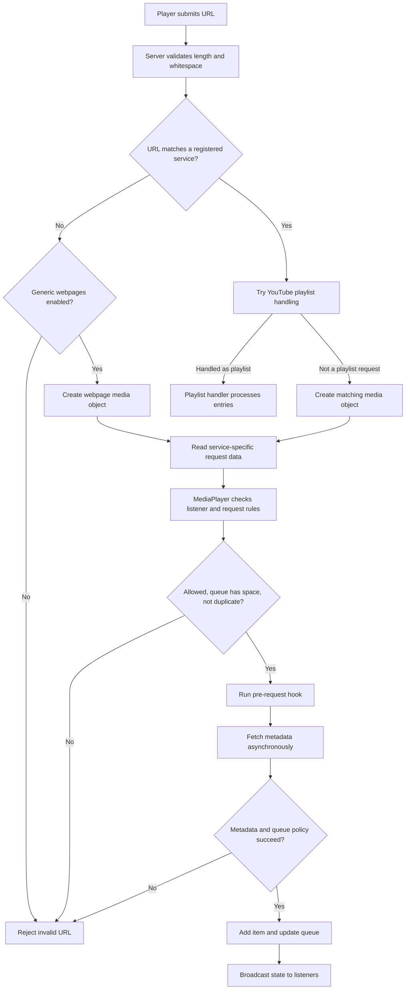

# Usage

## Spawnable screens

Open **Q → Entities → Media Player**. The addon registers several screen configurations, including:

| Spawn-menu entry | Purpose |
|---|---|
| Big Screen TV | Large TV screen |
| Huge Billboard | Wide billboard-style screen |
| Small TV | Compact screen |

The spawnable configurations and their screen transforms are defined in `lua/autorun/mediaplayer_spawnables.lua`. The actual screen entity class is `mediaplayer_tv`.

## Power and interaction

- Press **E** on a screen to activate/use it.
- Right-click and open the Sandbox properties for Media Player options.
- Hold **C** while looking at an active player to open the player sidebar/request UI.
- Use the sidebar to submit URLs and control playback/queue options.
- Fullscreen is a local client display mode; it does not change the playback state for other viewers.

## Requesting media

1. Look at a media-player screen or spatial media target.
2. Open the request UI (normally hold **C** while looking at the target).
3. Paste a supported URL and submit it.
4. The server matches the URL to a registered service, resolves metadata, checks permissions/whitelists, and queues the media.

A URL must match a built-in service unless the server has enabled `mediaplayer_allow_webpages`. See [Video services](video-services.md).

## Media request lifecycle

A normal URL request follows this server-side path. Playlist URLs are detected before a single media object is created; successful playlist handling queues its entries through the playlist implementation.

The server also applies a per-player request rate limit to incoming network messages. Spatial players perform their own service-whitelist check before the base queue-lock check. See [Permissions](permissions.md) for the permission model.

### YouTube playlists

A YouTube playlist URL can queue multiple videos. The server loads playlist entries and enqueues them in order, subject to these implementation limits:

- Up to 50 videos are processed per playlist request.
- The media-player queue limit still applies.
- A per-player cooldown prevents repeated playlist requests.
- Auto-generated Mix/radio playlists (`RD...`) are not supported as playlists; if the URL also identifies a video, that single video may still be requested.

Playlist support depends on YouTube's page structure and public accessibility; private or unavailable playlists cannot be loaded.

## Queue and playback controls

Available controls depend on ownership and privileges:

- Pause/resume playback
- Skip current media (non-privileged listeners may vote to skip)
- Seek timed media (privileged users)
- Remove queued media (owners can remove their own queued items; elevated users can remove others')
- Toggle repeat, shuffle, and queue lock (privileged users)
- Request new media

The queue length is capped by `mediaplayer_queue_limit`. A locked queue blocks ordinary requests from non-privileged users.

## Vote skip

Listeners can vote to skip the current item. A privileged user with skip access can skip immediately. The vote requirement is calculated by the vote-skip component from the current listener count.

## Fullscreen

The client ConVar `mediaplayer_fullscreen` and the player UI control local fullscreen presentation. Other viewers continue watching the shared screen normally.

## Duplication

Sandbox duplication is supported through `lua/autorun/sandbox/mediaplayer_dupe.lua`. The duplication module snapshots the media-player state and restores it when a duplicated screen is pasted. Behavior depends on the entity and snapshot data.

## Related

- [Installation](installation.md)
- [Configuration](configuration.md)
- [Permissions](permissions.md)
- [Spatial Media](spatial-media.md)
