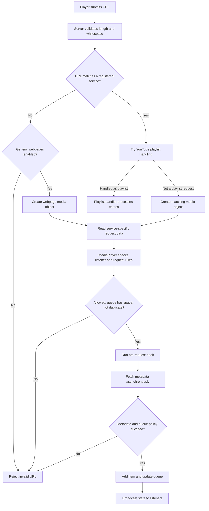

# Usage

> [!TIP]
> Quick start: spawn a screen from **Q → Entities → Media Player**, press **E** to activate it, then hold **C** while looking at it to open the player controls.

## Spawnable screens

Open **Q → Entities → Media Player**. The addon registers several screen configurations, including:

| Spawn-menu entry | Purpose |
|---|---|
| Big Screen TV | Large TV screen |
| Huge Billboard | Wide billboard-style screen |
| Small TV | Compact screen |

The spawnable configurations and their screen transforms are defined in `lua/autorun/mediaplayer_spawnables.lua`. The actual screen entity class is `mediaplayer_tv`.

## Keybindings and interaction

| Key / action | Behavior |
|---|---|
| **E** (Use) | Activate or deactivate the media player screen; this adds or removes you as a listener. |
| **C** (Context Menu) | Hold while looking at a screen to open the Media Player sidebar, including the queue, playback controls, and settings. The actual key follows your Garry's Mod context-menu binding. |
| **F11** | Toggle fullscreen for the screen you are looking at. Fullscreen is local to your client and does not change playback for other viewers. |
| **Right-click** | Open the Sandbox context/property menu for the screen and access the Media Player actions described below. |

The screen's idle hint uses your current context-menu binding. If you have rebound **C**, use the key shown by the game rather than assuming the default.

## Screen context-menu actions

The Media Player properties are available from the Sandbox context menu when you look at a compatible screen. Actions are shown according to the entity, playback state, and your permissions.

| Action | Behavior / access |
|---|---|
| **Pause / Resume** | Toggle playback for the screen. |
| **Skip** | This property action is shown to players with ownership or skip privileges and skips immediately. Ordinary listeners use the vote-skip control in the player UI, if available. |
| **Seek** | Enter a playback time and seek. Requires ownership or the `MediaPlayer_Seek` privilege (or `MediaPlayer_Admin`). Only timed media can be seeked. |
| **Request URL** | Open the media request browser. |
| **Copy URL** | Copy the current media URL to the clipboard; available while media is playing. |
| **Fullscreen** | Toggle fullscreen for that specific screen, equivalent to **F11** while looking at it. |
| **Turn On / Turn Off** | Join or leave the screen as a listener, equivalent to **E**. |

The Sandbox `CanProperty` gamemode hook can also prevent these property actions from being shown or used.

## Top menu bar

The Garry's Mod top menu bar includes a **Media Player** menu:

- **Fullscreen** toggles fullscreen for the screen you are currently targeting (or exits the current fullscreen player).
- **Turn Off All** leaves every active media player and closes the Media Player sidebar. This only disconnects your client as a listener; it does not stop playback for other viewers.

## Requesting media

1. Look at a media-player screen or spatial media target.
2. Open the request UI (normally hold **C** while looking at the target).
3. Paste a supported URL and submit it.
4. The server matches the URL to a registered service, resolves metadata, checks permissions/whitelists, and queues the media.

A URL must match a built-in service unless the server has enabled `mediaplayer_allow_webpages`. See [Video services](video-services.md).

## Media request lifecycle

A normal URL request follows this server-side path. Playlist URLs are detected before a single media object is created; successful playlist handling queues its entries through the playlist implementation.

The server also applies a per-player request rate limit to incoming network messages. Spatial players perform their own service-whitelist check before the base queue-lock check. See [Permissions](permissions.md) for the permission model.

### YouTube playlists

A YouTube playlist URL can queue multiple videos. The server loads playlist entries and enqueues them in order, subject to these implementation limits:

- Up to 50 videos are processed per playlist request.
- The media-player queue limit still applies.
- A per-player cooldown prevents repeated playlist requests.
- Auto-generated Mix/radio playlists (`RD...`) are not supported as playlists; if the URL also identifies a video, that single video may still be requested.

Playlist support depends on YouTube's page structure and public accessibility; private or unavailable playlists cannot be loaded.

## Queue and playback controls

Available controls depend on ownership and privileges:

- Pause/resume playback
- Skip current media (non-privileged listeners may vote to skip)
- Seek timed media (privileged users)
- Remove queued media (owners can remove their own queued items; elevated users can remove others')
- Toggle repeat, shuffle, and queue lock (privileged users)
- Request new media

The queue length is capped by `mediaplayer_queue_limit`. A locked queue blocks ordinary requests from non-privileged users.

## Vote skip

Listeners without immediate skip privileges can vote to skip the currently playing item.

- A skip passes when at least **two-thirds of the current listeners** have voted. The required count is rounded up: `ceil(listener_count × 2 / 3)`.
- Each listener can have only one active vote for the current item.
- Votes from players who disconnect or leave the media player are invalidated and no longer count.
- The vote count and required threshold are recalculated against the current listener list.
- Votes are cleared when the current media finishes and the next item is started.
- A player with ownership or the `MediaPlayer_Skip` / `MediaPlayer_Admin` privilege can skip immediately without a vote.

For example, 3 listeners require 2 votes; 4 listeners require 3 votes.

## Fullscreen

The client ConVar `mediaplayer_fullscreen` and the player UI control local fullscreen presentation. Other viewers continue watching the shared screen normally.

## Duplication

Sandbox duplication is supported through `lua/autorun/sandbox/mediaplayer_dupe.lua`. The duplication module snapshots the media-player state and restores it when a duplicated screen is pasted. Behavior depends on the entity and snapshot data.

---

## Related

- [Installation](installation.md)
- [Configuration](configuration.md)
- [Permissions](permissions.md)
- [Spatial Media](spatial-media.md)
